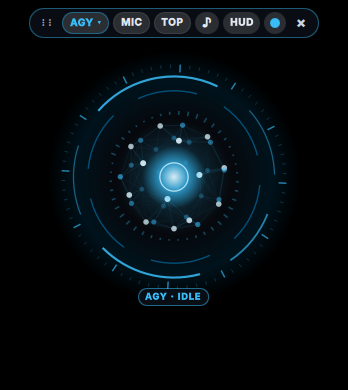

# J.A.R.V.I.S. for Omarchy

<p align="center">
  
</p>

A holographic desktop AI companion and Omarchy shell plugin for **Omarchy / Hyprland**, connected to your **Omarchy AI agents** (Antigravity, Claude Code, Codex, OpenCode, and more) with **100% offline local British neural TTS** (Kokoro-82M ONNX `bm_george`/`bm_daniel` blend, with Piper fallback) and hands-free voice input.

## Features

- **Omarchy Shell Plugin (`bar-widget` + `service`)** — Adds a theme-aware holographic core toggle to your Omarchy bar, exposes `omarchy-shell jarvis toggle|start|stop|setup` IPC commands, and registers a launcher entry automatically.
- **60 fps Holographic Core** — 3D-projected geodesic neural sphere, counter-rotating calibration rings, state-driven color/speed transitions (`idle`, `listening`, `thinking`, `working`, `speaking`, `error`), and a 30 fps audio-reactive equalizer synced to spoken syllables.
- **Draggable & Scroll-Resizable** — Frameless, transparent floating overlay that can be dragged anywhere on the desktop and resized smoothly by scrolling over J.A.R.V.I.S. (`110px`–`420px`, persisted automatically), with toggleable **Always on Top** (`TOP` / `PINNED`) powered by Hyprland `pin`.
- **Clean Auto-Hiding UI** — The top control bar and status badge hide until you hover over J.A.R.V.I.S., and the floating speech caption appears only while J.A.R.V.I.S. is speaking.
- **Multi-Agent + Omarchy Default Sync** — Follows your Omarchy default agent (`~/.config/omarchy/defaults/agent`) automatically, with a built-in agent selector (`AGY ▾`, `CLAUDE ▾`, `CODEX ▾`, etc.) and live model/approval controls.
- **Live Companion Mode** — Antigravity lifecycle hooks (`~/.gemini/config/hooks.json`) stream live session and tool state over a local Unix socket (`~/.local/share/jarvis/jarvis.sock`).
- **100% Offline British Voice & Hands-Free Mic** — Persistent Kokoro-82M ONNX TTS worker (`~/.local/share/jarvis/tts-venv`, with Piper fallback and optional `~/.config/jarvis/voice.json` tuning), PipeWire VAD microphone input via Superwhisper (`scripts/mic_worker.py`), and custom sound-pack overrides in `~/.local/share/jarvis/sounds/`.

## Install as an Omarchy Plugin

Install directly through the Omarchy plugin CLI:

```bash
omarchy plugin add https://github.com/Shlekka/omarchy-jarvis.git --enable
```

Then **click the J.A.R.V.I.S. icon in your Omarchy bar** (or run setup directly):

```bash
~/.config/omarchy/plugins/io.github.shlekka.jarvis/bin/setup --launch
```

`bin/setup` automatically:
1. Builds the Qt6 C++/QML `jarvis` binary (`qt6-base`, `qt6-declarative`, `qt6-wayland`).
2. Installs `jarvis` to `~/.local/bin/jarvis`, helper scripts to `~/.local/share/jarvis/`, and the app icon.
3. Provisions the offline British Kokoro-82M TTS environment in `~/.local/share/jarvis/tts-venv` (pass `--no-tts` to skip).
4. Adds the frameless transparent floating Hyprland window rule to `~/.config/hypr/hyprland.lua` (pass `--no-hypr` to skip).
5. Registers Antigravity live companion hooks in `~/.gemini/config/hooks.json` if Antigravity is configured (pass `--no-hooks` to skip).

### Optional: Arch Package Install (`PKGBUILD`)

If you prefer installing system-wide via `makepkg`:

```bash
./bin/install
```

## Shell IPC & Keybindings

While the plugin is enabled, you can control J.A.R.V.I.S. from anywhere or bind it in `~/.config/hypr/bindings.lua`:

```bash
omarchy-shell jarvis toggle
omarchy-shell jarvis start
omarchy-shell jarvis stop
omarchy-shell jarvis setup
```

- **Left-click bar icon**: Launch or hide J.A.R.V.I.S. (runs first-time setup if not built yet).
- **Right-click bar icon**: Open the J.A.R.V.I.S. setup/rebuild wizard in a floating terminal.

## Controls

| Control | Action |
| --- | --- |
| **Drag orb** | Move J.A.R.V.I.S. anywhere on desktop |
| **Scroll on orb** / `Ctrl+±` / `Ctrl+0` | Resize J.A.R.V.I.S. (saved automatically) |
| **Hover orb** | Reveal HUD bar & agent switcher |
| **Click orb** / `Ctrl+H` | Expand or collapse the interactive chat HUD |
| **Agent button** (`AGY ▾`) | Choose AI agent or follow Omarchy default |
| **MIC button** / `Ctrl+V` | Toggle hands-free microphone voice input |
| **TOP button** / `Ctrl+P` | Toggle Always on Top (`pin`) |
| **♪ button** / `Ctrl+M` | Mute / unmute offline British voice |
| `Ctrl+N` | Reset current agent conversation |
| `?` | Show / hide shortcuts overlay |
| `Ctrl+Q` / `×` | Quit |

## Voice Customization

Create `~/.config/jarvis/voice.json` to override the offline voice engine, Kokoro voice blend, or speaking speed:

```json
{
  "engine": "auto",
  "voice": "bm_george:0.65,bm_daniel:0.35",
  "speed": 1.0
}
```

Drop custom WAV files (`startup.wav`, `listen.wav`, `work.wav`, `done.wav`, `alert.wav`) into `~/.local/share/jarvis/sounds/` to override the synthesized holographic chimes.

## Development & Tests

```bash
./bin/build
./bin/test
omarchy plugin validate .
```

## License

MIT — see [LICENSE](LICENSE).
